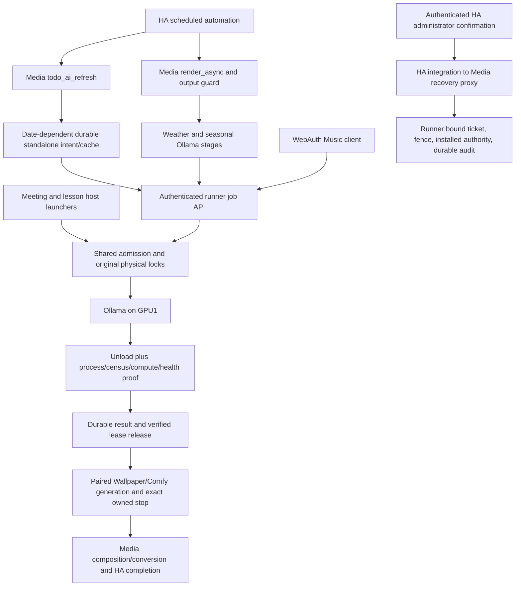

# Actual cross-service workflow and ownership boundaries

Hourly automation calls ToDo refresh, waits one minute, requests rendering, polls completion and requires full pipeline success. The daily ToDo automation generates HA tasks; it is not an independent inference replay permission. Relevant actual automation/configuration extracts accompany the audit; unrelated entities/member details are private. No schedule was changed during this audit.

Media `generate()` uses `StandaloneText` when no CURRENT_OPERATION exists. A UUID and exact request payload/hash are fsynced before submission. Later calls reconcile that same pending request using GET; an unknown outcome never creates a replacement ID. Terminal retired jobs produce retained failed receipts, and only a later independently authorized invocation may create a new operation. Successful content is cached by exact request hash; Toronto date is included in the ToDo prompt and the memory cache's day key. Daily quotes have their own date cache. The unused fallback in `_run` still contains the old deterministic formula, but ordinary `generate()` bypasses it via StandaloneText; this distinction matters to static review.

Cached ToDo data can be returned without inference while a different lease blocks dispatch. It does not clear ownership. Changed input with an unresolved intent is refused; terminal KnownJobFailure is classified runner_failed with permitted code, invalid model responses remain invalid_model_output. The output guard independently blocks render admission for reconciling owners. Thus a valid cache and blocked Wallpaper are compatible states.

Admission's durable logical owners survive failure after physical lock descriptors are released. An available OS flock and low VRAM alone do not authorize another inference. Completed inference is not a cleanup proof: unload, queues/residency, identities, compute attribution, process lifetimes, driver health and stable physical observations must pass before durable release. Routine GPU1 cleanup does not require stopping independent Music on GPU0.

Wallpaper owns both GPUs through its lifecycle. The helper pre-start compatibility guard checks accepted scope before launch; exact-stop/capture/barrier/native settlement are separate from Ollama idle-only retirement. The helper and Music scope now match the accepted runner scope. Music remains enabled with a 475 MiB GPU0 service ceiling and five-second cleanup budget; original lock identities are recorded.

HA uses the actual custom integration's authenticated WebSocket control. Its administrator requirement, explicit confirmation and Media's separate read/operate credentials forward only fixed actions to the runner. Read-only checks cannot execute the authority. Recovery binds exact job/lease/hash/boot/policy/scope and fresh exclusion evidence. Acknowledge only clears a display count. A lost mutation response permits Verify, not another Recover; the previous HA attempt remains historical.

Open WebUI and AnythingLLM are present and can be independent producers. Their captured runtime routing is summarized separately. Current connection/queue snapshots cannot prove that no direct/manual client existed at 08:01. The recovery gate protects cooperating entry points; it is not retrospective evidence of universal request attribution.

The retained Music validation permit still carries the old scope but has `enabled:false`. The active hook requires an enabled permit and exact scope/policy only for the validation path; the ordinary enabled settings match the current scope. This disabled historical record must not be rewritten to make an inventory superficially uniform.
